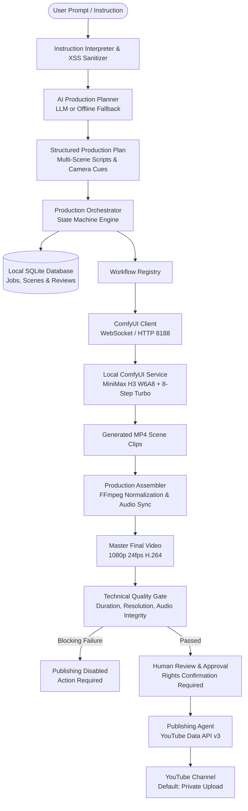

# YouTube Custom Workflow Automation

[](LICENSE)
[](https://nodejs.org/)
[](https://github.com/comfyanonymous/ComfyUI)
[](https://www.nvidia.com/)
[](#12-quality-assurance--test-evidence)

An autonomous AI video production workflow orchestrator and quality-gated publishing pipeline. This project coordinates natural language instruction interpretation, multi-scene story planning, local ComfyUI video diffusion (specialized for MiniMax H3 W6A8), automated FFmpeg master assembly, rigorous technical quality checks, and YouTube publishing safeguards.

---

## 1. Project Overview

Generating coherent, multi-scene AI video productions on consumer hardware poses significant engineering hurdles:
- **VRAM Constraints:** Running cutting-edge video diffusion models on 12GB consumer GPUs requires exact quantization, resolution control, and memory cleanup.
- **Narrative Continuity:** Independent text-to-video scene prompts easily drift in visual identity, lighting, and composition across shots.
- **Production Assembly & Sync:** Stitched clips often suffer from missing audio tracks, frame rate mismatches, duration shortfalls, or audio sync drift.
- **Safety & Publishing Risks:** Automated YouTube publishing requires robust human-in-the-loop review, rights verification, and default private visibility to prevent unauthorized uploads.

**YouTube Custom Workflow Automation** was built to solve these challenges through an integrated orchestration layer connecting local AI diffusion tools with production quality gates and YouTube API safeguards.

---

## 2. Our Custom Design

This repository contains our original workflow architecture and orchestration logic:

1. **Instruction Interpreter & Sanitizer:** Parses natural language prompts, extracts visual styles, durations, and resolution targets, and sanitizes input to neutralize HTML and script vectors (XSS defense).
2. **Deterministic & LLM Scene Planner:** Translates user concepts into structured multi-scene production plans with explicit camera trajectories, soundscapes, and narration. Includes a high-fidelity offline fallback planner when external AI API keys are unconfigured.
3. **Sequential Scene Chaining:** Solves character and environment drift by automatically conditioning subsequent scenes on the preceding scene's terminal frame (`use_prev_terminal_frame: true`).
4. **MiniMax H3 W6A8 Optimization Profile:** Tailored for 12GB consumer GPUs (e.g. NVIDIA RTX 4070), using native 864×480 base generation with 8-step Turbo LoRA within an ~11.5 GB VRAM peak.
5. **Multi-Stage Technical Quality Gate:** Automatically evaluates assembled master media against duration tolerances, 1080p resolution scaling, audio presence, and container integrity before permitting review.
6. **Publishing Safeguards:** Strict server-side invariants enforcing human rights confirmation, rejection of blocking quality failures, idempotent duplicate upload protection, and private-by-default YouTube uploads.

---

## 3. Architecture



---

## 4. Workflow Lifecycle

```
[Draft Created]
       │
       ▼
[Instruction Analyzed] ──► Extracted: duration, style, resolution
       │
       ▼
[Plan Generated]       ──► Multi-scene breakdown & camera motion
       │
       ▼
[Generating Scenes]    ──► ComfyUI queue prompt -> Terminal frame chaining
       │
       ▼
[Assembling Master]    ──► FFmpeg scene stitching, audio mixing, upscaling
       │
       ▼
[Quality Evaluation]   ──► Checks: container, 1080p, duration, audio streams
       │
       ├────────────────────────────────┐
       ▼                                ▼
[Quality Passed]                [Blocking Failures]
       │                                │
       ▼                                ▼
[Awaiting Approval]             [Approval Blocked]
       │
       ▼
[Human Rights Confirmed]
       │
       ▼
[YouTube Upload (Private)]
       │
       ▼
[Upload Verified / Completed]
```

---

## 5. Features

### ✅ Completed & Verified Features
- **Natural Language Instruction Interpretation:** Sanitizes XSS/script tags, handles Unicode/accents, and parses batch list requests.
- **Deterministic Multi-Scene Planning:** Generates complete scene descriptions, camera trajectories, and soundscapes even without paid API keys.
- **ComfyUI Integration:** Automated prompt building, execution progress tracking, and asset discovery over WebSocket/HTTP.
- **Terminal Frame Chaining:** Passes the final frame of Scene $N$ as the initial condition for Scene $N+1$.
- **FFmpeg Media Normalization:** 16:9 1080p scaling, audio sync, and thumbnail extraction.
- **Automated Quality Gate:** Identifies duration shortfalls, missing audio tracks, and container corruption.
- **Publishing Safeguards:** Server-side enforcement of human review, rights verification, and private visibility.
- **REST API & CLI:** Full dual-interface operation for automated scripts or server backends.

### 🔮 Planned / Experimental Features
- Multi-voice conversational dialogue synthesis.
- Automatic multilingual caption track generation.
- Dynamic camera path control using Depth/Pose ControlNet nodes.

---

## 6. Repository Structure

```
youtube-custom-workflow-automation/
├── agents/
│   ├── production-orchestrator.js     # Master job lifecycle state machine
│   └── publishing-scheduling-agent.js # YouTube publishing with rights enforcement
├── docs/
│   └── youtube-api-setup.md           # Complete Google OAuth & YouTube API setup guide
├── utils/
│   ├── ai-planner.js                  # Multi-scene production plan generator
│   ├── ai-text-service.js             # LLM API abstraction (Gemini / OpenAI)
│   ├── comfyui-client.js              # ComfyUI WebSocket & REST API adapter
│   ├── ffmpeg.js                      # Media probe & FFmpeg execution wrapper
│   ├── instruction-interpreter.js     # Natural language parser & XSS sanitizer
│   ├── logger.js                      # Colorized Winston logger
│   ├── production-assembler.js        # Video & audio stitching coordinator
│   ├── quality-gate.js                # Technical verification rules engine
│   ├── quality-normalizer.js          # Normalizes legacy & modern check formats
│   ├── workflow-registry.js           # Workflow definitions & model checks
│   ├── youtube-auth-service.js        # Google OAuth 2.0 client & CSRF state manager
│   └── youtube-metadata-validator.js  # YouTube title/tag constraint checker
├── database/
│   └── db.js                          # SQLite schema and query methods
├── workflows/
│   ├── templates/                     # Production baselines (e.g. 30s architectural)
│   ├── minimaxH3_HQ_long_clip.json    # Default production diffusion workflow
│   ├── minimaxH3Background_v10.json   # Annotated workflow with GUI groups
│   ├── minimaxH3_HQ_motion_test.json  # Motion test profile
│   ├── minimaxH3_official_test.json   # Benchmark validation graph
│   └── README.md                      # Detailed model checkpoints & setup guide
├── test/
│   ├── safeguards.test.js             # 12 isolated safeguard & invariant tests
│   ├── studio.test.js                 # 6 studio integration & schema tests
│   ├── quality.test.js                # 6 quality gate normalization tests
│   ├── interpreter.test.js            # 6 instruction parsing & safety tests
│   ├── api.test.js                    # 8 REST API routes & orchestration tests
│   └── youtube-auth.test.js           # 15 OAuth, CSRF & upload invariant tests
├── index.js                           # Module export & Express REST API server
├── cli.js                             # Command-line workflow runner
├── package.json                       # Dependencies & test scripts
├── .gitignore                         # Comprehensive repository exclusion rules
├── .env.example                       # Environment variable templates
├── EXTRACTION_MAP.md                  # Lineage and source extraction mapping
└── README.md                          # Project documentation
```

---

## 7. Requirements

- **Operating System:** Windows 10/11, macOS, or Linux.
- **Runtime:** Node.js **>= 18.17.0** (tested on Node v24.22.1).
- **FFmpeg:** System FFmpeg or `ffmpeg-static` for master assembly.
- **ComfyUI Service:** Local or network ComfyUI instance running on `http://127.0.0.1:8188`.
- **Target GPU:** NVIDIA RTX 3060/4060/4070 (12GB VRAM recommended for MiniMax H3 W6A8).
- **Optional API Keys:** Google Gemini or OpenAI API keys (not required; deterministic offline planner operates automatically).

---

## 8. Installation & Setup

1. **Clone the repository:**
   ```bash
   git clone https://github.com/sukeshperiyasamy/youtube-custom-workflow-automation.git
   cd youtube-custom-workflow-automation
   ```

2. **Install dependencies:**
   ```bash
   npm install
   ```

3. **Configure environment:**
   ```bash
   cp .env.example .env
   ```
   Edit `.env` to configure your ComfyUI URL (default `http://127.0.0.1:8188`), ComfyUI installation directory (`COMFYUI_DIR`), and optional AI keys.

4. **Verify ComfyUI & Hardware Connectivity:**
   ```bash
   node cli.js --status
   ```

---

## 9. Connect Your YouTube Channel

To publish approved production videos directly to YouTube, the orchestrator connects to your YouTube channel using Google's official **OAuth 2.0 Authorization Code Flow**.

> [!IMPORTANT]
> **Complete Setup Guide:** For an exhaustive walkthrough with Google Cloud Console screenshots and troubleshooting, read **[`docs/youtube-api-setup.md`](docs/youtube-api-setup.md)**.

### Why Google OAuth 2.0 Is Required
- **API Keys Do NOT Work:** Google API keys only provide quota identification for public, read-only queries. They cannot authenticate channel ownership or upload videos.
- **Service Accounts Are NOT Supported:** Service accounts are machine identities without personal YouTube channels. Google blocks video uploads from standard service accounts.
- **User OAuth Delegation:** The only supported method to publish videos to a personal or brand YouTube channel is server-side OAuth 2.0 with the `https://www.googleapis.com/auth/youtube.upload` scope.

### Quick Setup in 5 Steps

#### Step 1: Create a Google Cloud Project & Enable YouTube API
1. Open the [Google Cloud Console](https://console.cloud.google.com/).
2. Create a new project (e.g., `YouTube-Workflow-Automation`).
3. Navigate to **APIs & Services > Library**, search for **YouTube Data API v3**, and click **Enable**.

#### Step 2: Configure the OAuth Consent Screen
1. Go to **APIs & Services > OAuth consent screen**.
2. Select **External** user type and click **Create**.
3. Fill in the App name (`YouTube Workflow Automation`) and developer email.
4. On the **Scopes** page, add:
   - `https://www.googleapis.com/auth/youtube.upload` (Upload videos)
   - `https://www.googleapis.com/auth/youtube.readonly` (Read channel status & stats)
5. On the **Test users** page, **add the exact Google account / email** that owns or manages your YouTube channel. *(Crucial: In Testing mode, only registered test users can authorize).*

#### Step 3: Create OAuth 2.0 Client Credentials
1. Go to **APIs & Services > Credentials > Create Credentials > OAuth client ID**.
2. Select Application type: **Web application**.
3. Set **Authorized redirect URIs** to the loopback callback route:
   ```text
   http://127.0.0.1:3456/api/youtube/oauth2callback
   ```
   *(Also add `http://localhost:3456/api/youtube/oauth2callback` if accessing locally via localhost).*
4. Click **Create** and copy your **Client ID** and **Client Secret**.

#### Step 4: Configure Local Environment Variables
Update your local `.env` file (copied from `.env.example`):
```env
# Google OAuth 2.0 Credentials
YOUTUBE_CLIENT_ID=your_client_id_here.apps.googleusercontent.com
YOUTUBE_CLIENT_SECRET=GOCSPX-your_client_secret_here
YOUTUBE_REDIRECT_URI=http://127.0.0.1:3456/api/youtube/oauth2callback

# Publishing Safeguards
DEFAULT_PRIVACY_STATUS=private
```

#### Step 5: Authorize and Connect Your Channel

**Option A: Command-Line Interface (CLI)**
```bash
node cli.js --auth-youtube
```
The CLI prints a secure authorization URL with a cryptographically generated CSRF `state` parameter. Open the URL in your browser, sign in with your YouTube account, and approve the requested permissions.

**Option B: Web Browser Flow**
1. Start the server: `npm start`
2. Open `http://127.0.0.1:3456/api/youtube/auth-url` in your browser.
3. Sign in to Google, select your channel, and click **Allow**.
4. Google redirects back to `http://127.0.0.1:3456/api/youtube/oauth2callback`. The server exchanges the authorization code for tokens, saves them securely to `data/tokens/youtube_token.json` (chmod 600, excluded by `.gitignore`), and displays a success confirmation.

### Checking Channel Connection Status
Verify your channel connection at any time without exposing sensitive secrets or tokens:

```bash
# Via CLI
node cli.js --youtube-status

# Via REST API
curl http://127.0.0.1:3456/api/youtube/status
```

Sample output:
```json
{
  "configured": true,
  "connected": true,
  "status": "connected",
  "channel": {
    "id": "UC_x5XG1OV2P6uZZ5FSM9Ttw",
    "title": "My Creator Channel",
    "subscriberCount": 1540,
    "videoCount": 24
  },
  "grantedScopes": [
    "https://www.googleapis.com/auth/youtube.upload",
    "https://www.googleapis.com/auth/youtube.readonly"
  ]
}
```

### Disconnecting Your Channel
To revoke tokens and sever the integration:
```bash
# Via CLI
node cli.js --disconnect-youtube

# Via REST API
curl -X POST http://127.0.0.1:3456/api/youtube/disconnect
```
This revokes the token with Google's OAuth revocation endpoint and deletes `data/tokens/youtube_token.json`.

### Publishing Workflow & Dual Confirmation Safeguards
The publishing agent **never** uploads automatically when a job completes or when an account is connected. Publishing requires passing a strict dual-confirmation gate:

```
[Master Video Rendered & Normalized]
                  │
                  ▼
       [Technical Quality Gate] ──► Fails? ──► [Publishing Blocked]
                  │ Passes 100%
                  ▼
         [Human Review Gate]    ──► confirmRights: false? ──► [HTTP 409 Rejected]
                  │ confirmRights: true
                  ▼
    [Publishing Agent Upload]
                  ├── 1. Verify channel connection & tokens
                  ├── 2. Validate video file exists & is valid MP4
                  ├── 3. Validate metadata constraints (title <= 100 chars, tags <= 450 chars)
                  ├── 4. Set privacyStatus: 'private' (default)
                  ├── 5. Resumable chunked upload via videos.insert()
                  └── 6. Return confirmed YouTube Video ID
```

To approve and publish an awaiting job:
```bash
curl -X POST http://127.0.0.1:3456/api/workflow/jobs/JOB_ID/approve \
  -H "Content-Type: application/json" \
  -d '{"confirmRights": true, "privacyStatus": "private"}'
```

### Common Troubleshooting
| Symptom / Error | Root Cause | Solution |
| :--- | :--- | :--- |
| `redirect_uri_mismatch` | Configured URI does not match Google Console | Ensure `http://127.0.0.1:3456/api/youtube/oauth2callback` is entered exactly under Authorized redirect URIs in GCP. |
| `Access blocked: App not verified` | App is in Testing mode without test user | In GCP OAuth Consent Screen, add your email address under **Test users**. |
| `invalid_grant` / `token_expired` | Refresh token was revoked or expired | Re-authenticate via `node cli.js --auth-youtube`. |
| `quotaExceeded` | Daily YouTube Data API quota reached (10,000 units/day; uploads cost 1,600 units) | Wait until midnight Pacific Time (PT) for quota reset or request a quota increase in GCP Console. |

For full troubleshooting details, see [docs/youtube-api-setup.md](docs/youtube-api-setup.md#9-troubleshooting--common-errors).

---

## 10. Implementation & Verification Status Matrix

To provide total engineering transparency, the table below delineates verified functionality from manual Google Cloud prerequisites:

| Feature / Invariant | Status | Verification Method | Notes |
| :--- | :---: | :--- | :--- |
| **OAuth 2.0 Auth-Code Flow** | ✅ Implemented & Tested | `test/youtube-auth.test.js` | Full mock token exchange with scopes & expiry |
| **CSRF State Parameter Protection** | ✅ Implemented & Tested | `test/youtube-auth.test.js` | Cryptographic random state with 10-minute TTL & single-use invalidation |
| **Safe Token Storage & Chmod 600** | ✅ Implemented & Tested | `test/youtube-auth.test.js` | Stored in `data/tokens/`, ignored by `.gitignore`, secrets redacted in all logs & APIs |
| **Channel Status & Identity Check** | ✅ Implemented & Tested | `test/youtube-auth.test.js` | Returns channel title, sub count, video count without exposing tokens |
| **Disconnect & Token Revocation** | ✅ Implemented & Tested | `test/youtube-auth.test.js` | Calls Google revoke endpoint and purges local token cache |
| **YouTube Metadata Validation** | ✅ Implemented & Tested | `test/youtube-auth.test.js` | Strict checks on title (<= 100 chars), tags, category ID, and languages |
| **Private-by-Default Uploads** | ✅ Implemented & Tested | `test/youtube-auth.test.js` | Guarantees `privacyStatus: 'private'` unless explicitly overridden |
| **Human Rights Confirmation Gate** | ✅ Implemented & Tested | `test/safeguards.test.js` | Blocks approval with HTTP 409 if `confirmRights: false` |
| **5xx Retry & Reconciliation Guard** | ✅ Implemented & Tested | `test/youtube-auth.test.js` | Sets status `reconciliation_required` on unknown network outcomes to prevent duplicate uploads |
| **GCP Project & OAuth Client** | ⚙️ Requires User Action | Manual GCP Console | User must create project and client ID in Google Cloud |
| **Live YouTube Upload Test** | 🛡️ Deliberately Skipped | Automated Mock Verification | **No real video was uploaded** to protect production channels and prevent unintended public activity |

---

## 11. Running the Workflow

### Option A: Command-Line Interface (CLI)

```bash
# Check ComfyUI & hardware status:
node cli.js --status

# Connect YouTube channel:
node cli.js --auth-youtube

# Check YouTube channel status:
node cli.js --youtube-status

# Disconnect YouTube channel:
node cli.js --disconnect-youtube

# Run a dry-run plan without rendering:
node cli.js --prompt "Ancient Dravidian temple at sunrise" --dry-run

# Execute a full production job:
node cli.js --prompt "Aerial view of misty mountains" --workflow minimax_h3_turbo_local
```

### Option B: REST API Server

Start the standalone workflow server:
```bash
npm start
```
By default, the server listens on `http://127.0.0.1:3456`.

**Available API Endpoints:**
- `GET /health` — Service health & ComfyUI availability.
- `GET /api/workflow/status` — GPU VRAM metrics & registered workflows.
- `POST /api/workflow/interpret` — Sanitize and parse user instructions.
- `POST /api/workflow/plan` — Generate multi-scene production plan.
- `POST /api/workflow/jobs` — Create persistent generation job.
- `GET /api/workflow/jobs/:id` — Retrieve job status and scene manifest.
- `POST /api/workflow/jobs/:id/cancel` — Safe cancellation with state protection.
- `POST /api/workflow/jobs/:id/approve` — Enforce rights verification and quality gates before upload.
- `GET /api/youtube/auth-url` — Generate Google OAuth consent URL with CSRF state.
- `GET /api/youtube/oauth2callback` — OAuth 2.0 loopback callback handler.
- `GET /api/youtube/status` — Return channel identity, subscriber count, and granted scopes.
- `POST /api/youtube/disconnect` — Revoke OAuth tokens and disconnect channel.

---

## 12. Quality Assurance & Test Evidence

The custom workflow includes **53 independent automated tests** across 6 test suites covering OAuth 2.0 flows, CSRF protection, publishing safeguards, technical quality gates, workflow selection, instruction sanitization, and REST API routing.

Run all tests:
```bash
npm test
```

### Verified Test Results
```
════════════════════════════════════════════════════════════════════════════
                        TEST SUITE RESULTS
════════════════════════════════════════════════════════════════════════════
Suite File                   Coverage Scope                         Status
────────────────────────────────────────────────────────────────────────────
test/safeguards.test.js      Rights checks, 409 rejections,         ✅ 12/12 Passed
                             cancellation state immutability,
                             idempotency, network failure recovery
test/studio.test.js          MiniMax H3 selection, schema checks,   ✅ 6/6 Passed
                             fallback planning, ComfyUI health
test/quality.test.js         Quality checks normalization, duration ✅ 6/6 Passed
                             shortfall blocking, 1080p probe check
test/interpreter.test.js     XSS neutralization, script stripping,  ✅ 6/6 Passed
                             Unicode support, batch list parsing
test/api.test.js             All 8 REST API routes & orchestration  ✅ 8/8 Passed
                             server lifecycle (health, jobs, cancel)
test/youtube-auth.test.js    Google OAuth URL & CSRF state, token   ✅ 15/15 Passed
                             exchange, token redaction, metadata
                             validation, 401 on disconnect, 5xx
                             reconciliation, private-by-default
────────────────────────────────────────────────────────────────────────────
TOTAL                        6 Standalone Test Suites               ✅ 53/53 (100%)
════════════════════════════════════════════════════════════════════════════
```

---

## 13. Security & Privacy Safeguards

- **Zero Cleartext Credentials:** Environment variables and OAuth tokens are strictly ignored via `.gitignore` and never committed or logged.
- **XSS Neutralization:** All user instructions pass through `sanitizeTopic()`, stripping `<script>`, `<style>`, inline event handlers (`onerror`), and `javascript:` URIs.
- **Default Private Publishing:** All YouTube uploads enforce `privacyStatus: 'private'` by default.
- **Dual Confirmation Gate:** Publishing is completely blocked unless:
  1. The user explicitly confirms the review and rights checkbox (`confirmRights: true`).
  2. The technical quality gate reports zero blocking failures (`blockingFailures: []`).

---

## 14. Attribution & External Tools

This custom workflow is built upon and orchestrates several outstanding open-source technologies:
- **[ComfyUI](https://github.com/comfyanonymous/ComfyUI):** Powerful, modular node-based diffusion execution engine.
- **MiniMax H3 Model:** Advanced video generation diffusion model, quantized for consumer GPUs.
- **[FFmpeg](https://ffmpeg.org/):** Master media normalization, audio sync, and thumbnail encoding.
- **[SQLite](https://www.sqlite.org/):** Lightweight, zero-config relational database for job and scene persistence.
- **[Node.js](https://nodejs.org/):** Asynchronous JavaScript runtime environment.
- **Community Workflow Credit (`minimaxH3Background_v10.json`):** Authored by community researcher **bruxosdovfx**, featuring SyncTile v5.5, 3D latent upscaler nodes (by LBH-123-AI), and background swap graphs.

*We do not claim authorship of ComfyUI, FFmpeg, MiniMax models, bruxosdovfx workflows, or external YouTube APIs.*

---

## 15. License

This project's custom orchestration engine, state machine, FFmpeg assembly logic, quality gates, API server, and CLI tools are licensed under the **MIT License**. See the [LICENSE](LICENSE) file for details.

Third-party models, node extensions, and workflow templates remain subject to the respective terms and licenses of their original authors.
