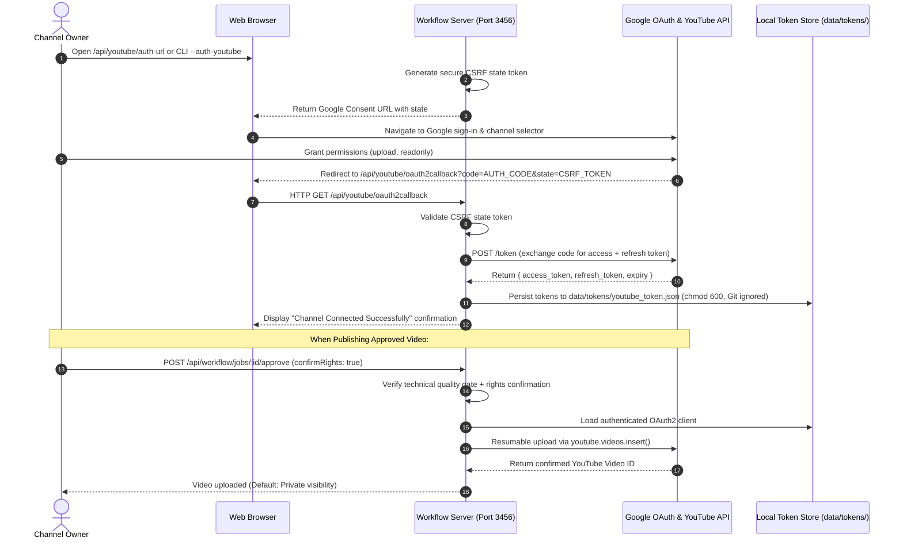

# YouTube Data API v3 & Google OAuth 2.0 Setup Guide

This guide provides step-by-step instructions for connecting your personal or brand YouTube channel to the **YouTube Custom Workflow Automation** orchestrator using official Google OAuth 2.0 authorization code flow.

---

## Table of Contents
1. [Architecture Overview & Auth Flow](#1-architecture-overview--auth-flow)
2. [Step A: Create Google Cloud Project & Enable YouTube API](#2-step-a-create-google-cloud-project--enable-youtube-api)
3. [Step B: Configure OAuth Consent Screen & Test Users](#3-step-b-configure-oauth-consent-screen--test-users)
4. [Step C: Create OAuth 2.0 Client Credentials](#4-step-c-create-oauth-20-client-credentials)
5. [Step D: Configure Local Environment Variables](#5-step-d-configure-local-environment-variables)
6. [Step E: Connect Your YouTube Channel (Browser & CLI)](#6-step-e-connect-your-youtube-channel-browser--cli)
7. [Step F: Verification, Status Checks & Disconnecting](#7-step-f-verification-status-checks--disconnecting)
8. [Step G: Publishing Safeguards & Upload Lifecycle](#8-step-g-publishing-safeguards--upload-lifecycle)
9. [Troubleshooting & Common Errors](#9-troubleshooting--common-errors)
10. [Official Documentation References](#10-official-documentation-references)

---

## 1. Architecture Overview & Auth Flow

YouTube video uploads **require user-level OAuth 2.0 delegation**.

> [!IMPORTANT]
> **Why API Keys and Service Accounts Cannot Be Used:**
> - **API Keys:** Only authenticate project quotas for public, read-only data (e.g. searching public videos). They **cannot** write data or upload videos to a channel.
> - **Service Accounts:** Represent machine accounts and do **not** possess YouTube channels or identities. Google does not support YouTube video uploads via standard service accounts.
> - **User OAuth 2.0 Authorization Code Flow:** The only supported mechanism for uploading videos to an authorized YouTube channel.



---

## 2. Step A: Create Google Cloud Project & Enable YouTube API

1. Navigate to the **[Google Cloud Console](https://console.cloud.google.com/)**.
2. Sign in with the Google account that manages or owns your YouTube channel.
3. Click the project dropdown at the top of the console and select **New Project**.
   - **Project Name:** `YouTube-Workflow-Automation` (or your preferred name).
   - **Organization:** Select *No organization* (for personal accounts) or your workspace.
   - Click **Create**.
4. Enable the YouTube API:
   - Go to **APIs & Services > Library** ([API Library](https://console.cloud.google.com/apis/library)).
   - Search for **YouTube Data API v3**.
   - Click on **YouTube Data API v3** and click **Enable**.

---

## 3. Step B: Configure OAuth Consent Screen & Test Users

1. In the Google Cloud Console, navigate to **APIs & Services > OAuth consent screen**.
2. **User Type:** Select **External** and click **Create**.
3. **App Information:**
   - **App name:** `YouTube Workflow Automation`
   - **User support email:** Select your email address.
   - **Developer contact information:** Enter your email address.
   - Click **Save and Continue**.
4. **Scopes:**
   - Click **Add or Remove Scopes**.
   - Select or manually add:
     - `https://www.googleapis.com/auth/youtube.upload` (Upload videos and manage metadata)
     - `https://www.googleapis.com/auth/youtube.readonly` (Read channel profile and status for verification)
   - Click **Update** and **Save and Continue**.
5. **Test Users (Crucial for Apps in Testing Mode):**
   - Click **Add Users**.
   - Enter the exact Google email address that owns the YouTube channel you want to connect.
   - Click **Save and Continue**.

> [!TIP]
> While your app is in **Testing** publishing status, only accounts explicitly listed under **Test users** can authorize the channel. You do not need to submit the application for Google verification for private or personal channel automation.

---

## 4. Step C: Create OAuth 2.0 Client Credentials

1. Navigate to **APIs & Services > Credentials** ([Credentials Console](https://console.cloud.google.com/apis/credentials)).
2. Click **+ Create Credentials** at the top and select **OAuth client ID**.
3. **Application type:** Select **Web application**.
   - *Name:* `YouTube Workflow Web Client`
4. **Authorized JavaScript origins:**
   - Click **+ Add URI** and add:
     - `http://127.0.0.1:3456`
     - `http://localhost:3456`
5. **Authorized redirect URIs:**
   - Click **+ Add URI** and enter the exact callback endpoint:
     - `http://127.0.0.1:3456/api/youtube/oauth2callback`
     - `http://localhost:3456/api/youtube/oauth2callback`
6. Click **Create**.
7. Google will display a modal with your **Client ID** and **Client Secret**.
   - Copy both strings. (You can also download the JSON file for your reference, but do **not** commit it).

---

## 5. Step D: Configure Local Environment Variables

1. In your local repository clone, copy `.env.example` to `.env`:
   ```bash
   cp .env.example .env
   ```
2. Open `.env` and fill in your credentials:
   ```env
   # ==============================================================================
   # YouTube Data API v3 & Google OAuth 2.0
   # ==============================================================================
   YOUTUBE_CLIENT_ID=your_client_id_here.apps.googleusercontent.com
   YOUTUBE_CLIENT_SECRET=GOCSPX-your_client_secret_here
   YOUTUBE_REDIRECT_URI=http://127.0.0.1:3456/api/youtube/oauth2callback
   YOUTUBE_TOKEN_PATH=data/tokens/youtube_token.json

   # Video Production & Publishing Defaults
   DEFAULT_VIDEO_VISIBILITY=private
   REQUIRE_HUMAN_APPROVAL=true
   AUTO_PUBLISH_ENABLED=false
   ```

> [!CAUTION]
> **Credential Security:** Never commit `.env` or files in `data/tokens/` to version control. Both are strictly excluded in `.gitignore`.

---

## 6. Step E: Connect Your YouTube Channel (Browser & CLI)

You can authorize your channel using either the web application server or the CLI runner:

### Method 1: Web Browser Authorization (Recommended)

1. Start the workflow server:
   ```bash
   npm start
   ```
   *(Server starts listening on `http://127.0.0.1:3456`)*
2. In your web browser, navigate to:
   ```
   http://127.0.0.1:3456/api/youtube/auth-url
   ```
3. Open the returned `authUrl` in your browser.
4. Google will ask you to:
   - Sign in with your Google account.
   - Choose the target YouTube channel.
   - If you see *"Google hasn't verified this app"*, click **Advanced** -> **Go to YouTube Workflow Automation (unsafe)**.
   - Check the boxes to allow video uploads and channel profile view.
5. Google will redirect back to:
   ```
   http://127.0.0.1:3456/api/youtube/oauth2callback?code=...&state=...
   ```
6. The browser will display:
   > **YouTube Channel Connected Successfully!**  
   > *Your channel is now authorized for approved video uploads.*

### Method 2: Command-Line Interface (CLI)

1. Run the authorization helper:
   ```bash
   node cli.js --auth-youtube
   ```
2. The CLI will output the Google consent URL:
   ```
   🔐 YouTube Channel OAuth 2.0 Authorization

   1. Open this URL in your web browser to authorize your YouTube channel:
      https://accounts.google.com/o/oauth2/v2/auth?access_type=offline&prompt=consent...
   ```
3. Open the URL in your browser while your server (`npm start`) is running to complete the authorization code exchange.

---

## 7. Step F: Verification, Status Checks & Disconnecting

### Check Channel Connection Status

Check connection status at any time without exposing tokens or secrets:

- **Via CLI:**
  ```bash
  node cli.js --youtube-status
  ```
  *Output when connected:*
  ```
  📺 Checking YouTube Channel Authorization Status:
    • Channel Status:    ✅ Connected
    • Channel Title:     My Channel Name
    • Channel ID:        UCxxxxxxxxxxxxxxxxxxxx
    • Subscribers:       1,250
    • Total Videos:      42
    • Granted Scopes:    youtube.upload, youtube.readonly
    • Token Expires At:  2026-10-25T21:45:00.000Z
  ```

- **Via REST API:**
  ```bash
  curl http://127.0.0.1:3456/api/youtube/status
  ```

### Disconnect & Revoke Access

To cleanly revoke tokens with Google and remove stored credentials from disk:

- **Via CLI:**
  ```bash
  node cli.js --disconnect-youtube
  ```
- **Via REST API:**
  ```bash
  curl -X POST http://127.0.0.1:3456/api/youtube/disconnect
  ```

---

## 8. Step G: Publishing Safeguards & Upload Lifecycle

The orchestrator enforces strict server-side invariants to prevent unauthorized, premature, or corrupt uploads:

1. **Dual Confirmation Gate:**
   Publishing is completely blocked unless:
   - `confirmRights: true` is explicitly provided by the user.
   - The technical quality gate reports zero blocking failures (`blockingFailures: []`).
2. **Private by Default:**
   All uploads default to `privacyStatus: 'private'` unless explicitly overridden.
3. **Resumable Uploads & Duplicate Prevention:**
   If an upload network error occurs midway, the job transitions to `reconciliation_required` to prevent accidental duplicate videos on YouTube.
4. **Approval API Call:**
   ```bash
   curl -X POST http://127.0.0.1:3456/api/workflow/jobs/<JOB_ID>/approve \
     -H "Content-Type: application/json" \
     -d '{"confirmRights": true}'
   ```

---

## 9. Troubleshooting & Common Errors

| Error Code / Message | Root Cause | Solution |
| :--- | :--- | :--- |
| **`redirect_uri_mismatch` (400)** | The redirect URI sent by the app does not match Google Cloud credentials. | Ensure `http://127.0.0.1:3456/api/youtube/oauth2callback` is entered **character-for-character** in Google Cloud Console > Credentials > Authorized redirect URIs. Note that `127.0.0.1` and `localhost` are treated as different URIs. |
| **`access_denied` (403)** | User cancelled the OAuth prompt, or user is not listed as a Test User. | While the app is in "Testing" mode, add your email address under **OAuth consent screen > Test users**. |
| **`invalid_grant`** | The authorization code expired (codes last only a few minutes) or the refresh token was revoked. | Re-run `node cli.js --auth-youtube` and complete authorization immediately in the browser. |
| **`accessNotConfigured`** | YouTube Data API v3 has not been enabled in the Google Cloud project. | Open **APIs & Services > Library**, search for **YouTube Data API v3**, and click **Enable**. |
| **`quotaExceeded` (403)** | Daily API quota exceeded (free default is 10,000 units/day; video inserts cost 1,600 units). | Wait for quota reset at midnight Pacific Time, or request a quota increase in the Google Cloud Console. |
| **`CSRF_STATE_MISMATCH`** | The OAuth `state` parameter did not match an active session token. | You may have taken longer than 10 minutes to authorize or used a stale link. Generate a fresh link via `/api/youtube/auth-url`. |
| **`channel_not_found`** | The Google account signed in does not have an active YouTube channel created yet. | Open [YouTube](https://www.youtube.com) while signed in to that account, click your profile picture, and select **Create a channel**. |

---

## 10. Official Documentation References

- **Registering an Application:** [Google Developers — Registering Application](https://developers.google.com/youtube/registering_an_application)
- **YouTube API Authentication Guide:** [Google Developers — YouTube Authentication](https://developers.google.com/youtube/data/guides/authentication)
- **Server-Side Web Apps OAuth:** [Google Developers — Server-Side Web Apps](https://developers.google.com/youtube/data/guides/auth/server-side-web-apps)
- **Uploading Videos Guide:** [Google Developers — Uploading a Video](https://developers.google.com/youtube/data/guides/uploading_a_video)
- **Videos.insert API Reference:** [Google Developers — Videos: insert](https://developers.google.com/youtube/data/reference/rest/v3/videos/insert)
